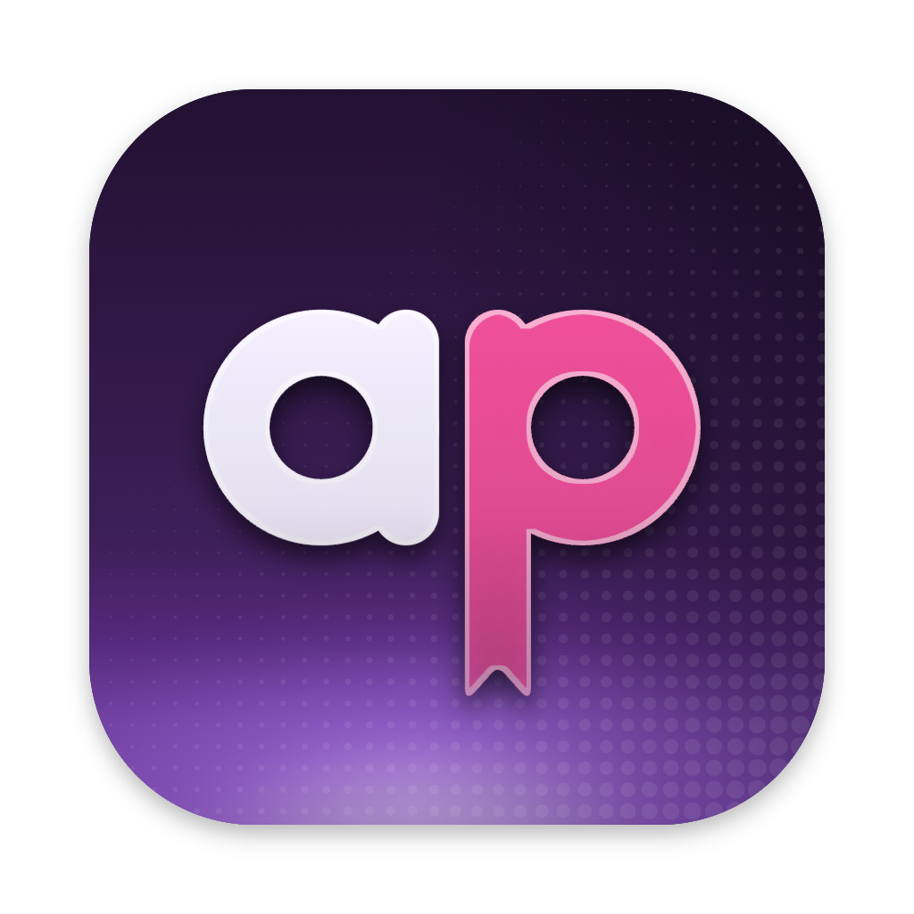

# Anipoex

**An AniList manga tracker that compares every source for each manga and syncs privately across iOS, Android, macOS and Windows.**

> One manga, many sources: Anipoex reads them all, tells you which one is ahead, and follows you to every device you use, through storage only you own.

> [!IMPORTANT]
> **Anipoex is a tracker and reader client only.** It hosts, provides and distributes no content, and has no affiliation with any content provider or extension repository.
>
> **Extensions are third-party.** Anipoex ships with none: you add the repositories and extensions yourself, and you are responsible for what they load and for following the laws and terms that apply to you.
>
> **Not a Mihon fork, and not affiliated with AniList or Mihon.** Anipoex is its own app, written from scratch in React Native. Only its extension host adapts the extension API classes from Mihon (Apache-2.0, see [NOTICE](modules/extension-runtime/NOTICE)), so that Mihon extensions can run. AniList is used through its public API with your own account.

  
  
  
    
  <a href="https://anipoex.github.io"><b>anipoex.github.io</b></a> · <a href="#-multi-source-per-manga">Multi-source</a> · <a href="#-private-sync-on-every-platform">Private sync</a> · <a href="#-how-it-differs">How it differs</a> · <a href="#-download">Download</a> · <a href="#-docs">Docs</a> · <a href="#-roadmap">Roadmap</a>

---

## 🔀 Multi-source, per manga

Your list lives on your tracker ([AniList](https://anilist.co) today), and each manga reads from every source you installed through [Mihon](https://github.com/mihonapp/mihon) extensions:

- **`+N` per source**: how many chapters each one has past your progress.
- **The furthest ahead wins**, picked for you with Undo, unless you chose one by hand.
- **Bad sources step aside**: outdated, missing or failing ones are excluded for that manga and checked again a week later.
- **Your whole Reading list at once**: one scan tells you which manga have new chapters.

How a scan decides: [Sync and source picking](docs/sync-and-sources.md#how-a-scan-picks-a-source). The scan rules come from the [manga-source-updates](https://github.com/Carloss616/seanime-extensions/tree/main/src/plugins/manga-source-updates) plugin for Seanime.

## 🔐 Private sync, on every platform

iOS, Android, macOS and Windows share one setup: source picks, scan results, settings, installed extensions and where you stopped reading.

- **Storage you own**: a private GitHub gist, a folder synced by iCloud Drive, OneDrive or Syncthing, or both. No Anipoex account, no server.
- **Per-device truth**: your own choices travel; failures and automatic picks stay on the device where they happened.

What travels and what stays: [Sync and source picking](docs/sync-and-sources.md#what-syncs).

---

## 🆚 How it differs

What Anipoex does that the apps it learns from don't, side by side:

| | Anipoex | [Mihon](https://github.com/mihonapp/mihon) | [Seanime](https://github.com/5rahim/seanime) | [AnymeX](https://github.com/RyanYuuki/AnymeX) |
|---|---|---|---|---|
| **Every source compared per manga**, the furthest ahead picked | ✅ Automatic, with Undo | ❌ One source per entry, migrated by hand | ➖ With the [manga-source-updates](https://github.com/Carloss616/seanime-extensions/tree/main/src/plugins/manga-source-updates) plugin | ❌ A tracking client, not a reader |
| **Mihon extensions beyond Android**, with no server | ✅ Android, iOS, macOS, Windows | ➖ Android only | ❌ Its own extension marketplace | ❌ Not a reader |
| **Private sync on every device**, with no server | ✅ Your gist or folder | ➖ Backups you move yourself | ➖ Your self-hosted server | ➖ Lists only, through the tracker |
| **Your tracker is the library**, no second one to keep in step | ✅ AniList today, more planned | ❌ Its own library; trackers get progress one way | ➖ AniList plus a local file library | ✅ AniList, MyAnimeList or Simkl |
| **Native UI on each platform** | ✅ SwiftUI on iOS, Compose on Android | ✅ Compose, Android only | ➖ A web UI | ➖ One Flutter UI everywhere |

---

## ✨ Features

| Feature | Description |
|---------|-------------|
| 🔀 Multi-source scans | Every source per manga compared, the furthest ahead picked |
| 🔐 Private sync | Your setup on every device, through your gist or folder |
| 📋 AniList tracking | Your list by status, with progress, score and dates |
| 🧩 Mihon extensions | Add repos and install extensions, checked against the repo's signing key |
| 📖 Reader and downloads | Read from the chosen source, or download chapters for later |
| 📱 Native on each platform | SwiftUI on iOS, Jetpack Compose on Android, desktop apps for macOS and Windows |

---

## 📥 Download

There are no releases yet. Until then, build it from source: see [CONTRIBUTING.md](CONTRIBUTING.md#-build-and-run).

> [!NOTE]
> Extensions download code at runtime, which app stores don't allow: the iOS build will be sideloaded and the Android build will ship outside Google Play.

---

## 📚 Docs

- [Mihon extensions](docs/extensions.md): how extensions run on Android, iOS and the desktop app.
- [Sync and source picking](docs/sync-and-sources.md): what syncs between your devices, and how a scan picks a source.
- [Desktop app](desktop/README.md): run and package the desktop app.
- [Contributing](CONTRIBUTING.md): build and run, tech stack, project structure.

---

## 🗺️ Roadmap

- [x] AniList list, detail and tracking
- [x] Mihon extensions on Android, iOS, macOS and Windows
- [x] Source scans, auto-exclusion and auto-pick
- [x] Reader
- [x] Sync through a GitHub gist or a folder
- [x] Desktop app for macOS and Windows
- [x] Chapter downloads
- [x] Reading position synced between devices
- [ ] More trackers beyond AniList
- [ ] iOS extension runtime on a physical iPhone
- [ ] Signed macOS builds
- [ ] Windows installer (packaging builds only the macOS `.dmg` today)

---

## 📄 License

[Carlos Espinoza](https://github.com/Carloss616). Licensed under [MIT](LICENSE).
