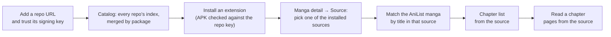
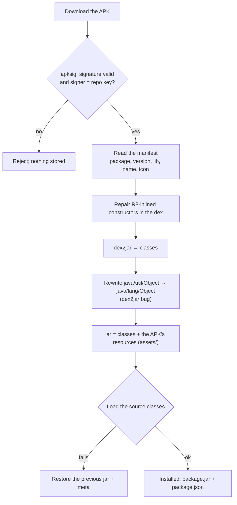
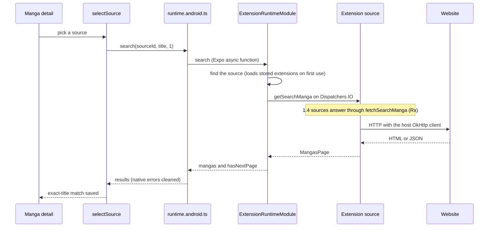
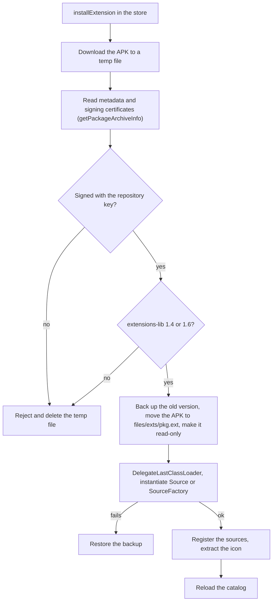
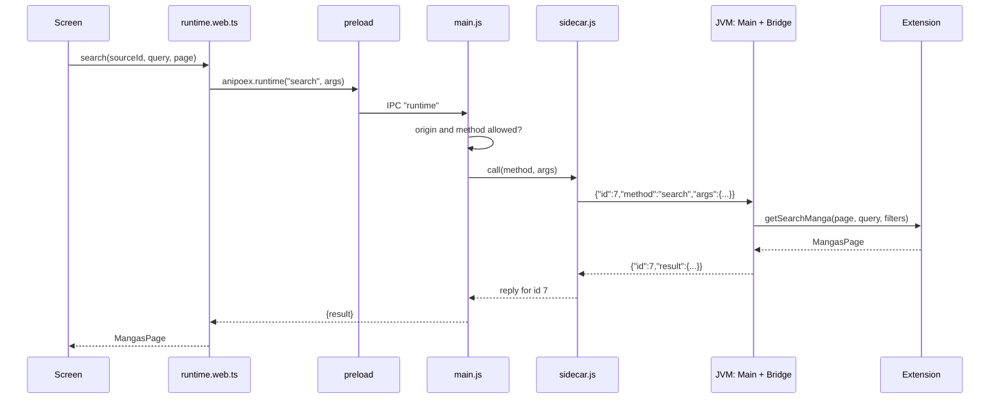
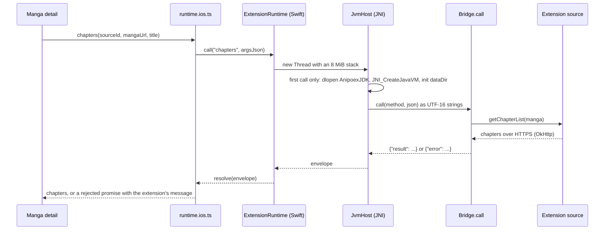
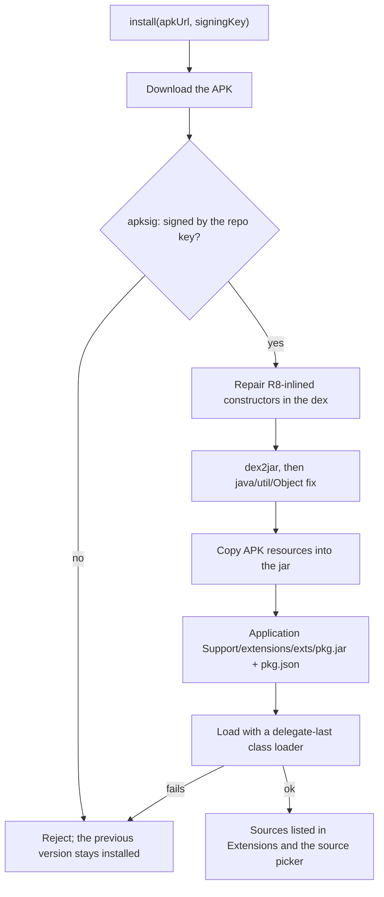

# Mihon extensions

anipoex runs [Mihon](https://github.com/mihonapp/mihon) extensions (extensions-lib 1.4 and 1.6) inside the app on Android, iOS and the macOS desktop app, with no server. The web app in a browser shows the catalog but can't install. What an extension, a repo or a source *means* lives in [okf/](../okf/index.md); this page shows how the pieces fit.

## Overview

Every platform answers the same `RuntimeApi` (`src/features/extensions/runtime/runtime.ts`), so the screens don't know where the extensions run. Below the bridge, all three load the same host classes (`eu.kanade.tachiyomi.*`, in `modules/extension-runtime/android/src/main/java`), the API extensions are compiled against. Android runs them in ART; desktop and iOS compile them into one JVM jar (`modules/extension-runtime/jvm`) with Android shims, reached through a single entry point, `Bridge.call(method, json)`.

```mermaid
flowchart TD
    UI["Screens: Extensions, Repositories, source picker, manga detail"]
    API["RuntimeApi<br/>install · installed · uninstall · search · chapters · pages · mangaWebUrl"]
    UI --> API

    subgraph AND["Android"]
        A1["runtime.android.ts"]
        A2["Expo module<br/>ExtensionRuntimeModule.kt"]
        A3["ART class loader<br/>loads the APK as is"]
        A1 --> A2 --> A3
    end

    subgraph DESK["macOS desktop (Electron)"]
        D1["runtime.web.ts<br/>window.anipoex"]
        D2["preload + IPC<br/>main.js"]
        D3["Sidecar: JVM process<br/>JSON lines on stdin/stdout"]
        D1 --> D2 --> D3
    end

    subgraph IOS["iOS"]
        I1["runtime.ios.ts"]
        I2["Expo module<br/>ExtensionRuntimeModule.swift"]
        I3["Embedded JVM in the app<br/>JNI via JvmHost"]
        I1 --> I2 --> I3
    end

    API --> A1
    API --> D1
    API --> I1

    CORE["JVM core (modules/extension-runtime/jvm)<br/>Bridge.call · apksig · dex repair · dex2jar · Android shims"]
    D3 --> CORE
    I3 --> CORE

    HOST["Host classes eu.kanade.tachiyomi.*<br/>one source, compiled into the Android app<br/>and into the JVM core"]
    A3 --> HOST
    CORE --> HOST

    EXT["Extension code<br/>(the repo's signed APK)"]
    HOST --> EXT
```

Desktop and iOS share `bridgeRuntime` (`runtime/utils/bridge-runtime.ts`), which turns the `{result}` / `{error}` envelope that `Bridge.call` returns into `RuntimeApi`. The web app in a browser has no bridge, so `runtime.ts` answers with an empty list and a "runs in the Android, iOS and desktop apps" error.

## What the user does

The flow is the same on every platform; only the runtime underneath changes.

Repos, the catalog and the picked source are JavaScript (`src/features/extensions`, `src/features/manga`); only installing and calling a source cross into the runtime.

`pages(sourceId, chapterUrl, memo?)` returns `[{ index, imageUrl, headers }]`: the chapter's images with the headers each one needs (Referer, for example). Android and iOS load them with expo-image, sending those headers. `memo` is the chapter's `SChapter.memo` from `chapters`, as an opaque JSON string (null when empty): lib 1.6 sources store data there while listing and read it back in `getPageList`, so the reader passes it along. Known limit: sources that rewrite or unscramble images in their OkHttp client interceptors don't work yet, since the app downloads with the URL and headers only.

## Installing an APK on the JVM (desktop and iOS)

Android loads the APK as is with a `DelegateLastClassLoader`. The JVM can't run dex, so desktop and iOS convert it first. The signature is checked before any extension code is touched, and a failure at any step leaves the previous version installed.

## Android

The Android runtime lives in `modules/extension-runtime/android`: an Expo module (`ExtensionRuntimeModule.kt`) plus the `eu.kanade.tachiyomi.*` host classes, adapted from Mihon and compiled into the app. These are the same source files the JVM core compiles for desktop and iOS, but Android doesn't use the JVM core itself. JS reaches it through `src/features/extensions/runtime/runtime.android.ts` (`requireNativeModule("ExtensionRuntime")`). An installed extension is the repository's APK, stored privately as `files/exts/<pkg>.ext` (read-only) and loaded with a `DelegateLastClassLoader` whose parent is the app's class loader, so the extension's own classes win and the host API comes from the app. ART runs the dex as is: no JVM, no dex repair, no dex2jar. Both extensions-lib 1.4 (RxJava) and 1.6 (suspend) are supported; signatures are read by `PackageManager`, the icon is extracted from the APK, and consumer R8 rules keep the host API in release builds.

Known limits:

- Cloudflare challenges are not solved yet (the Cloudflare interceptor passes requests through) and there is no cookie jar.
- Not provided yet: QuickJS (`JavaScriptEngine`), `rateLimit`/`rateLimitHost`, `HttpSource.fetchImage`; an extension that calls them fails when that code runs.
- Extensions are private to the app, not installed Android packages: extensions installed by Mihon in its shared mode are not seen, and ours are invisible to other apps.
- Google Play does not allow loading code downloaded at runtime, so the Android build is distributed outside Play.
- Release builds keep kotlin, OkHttp, Okio, Jsoup, RxJava, kotlinx and Injekt whole through consumer R8 rules, so those libraries are not shrunk.
- The debug dev client janks on Compose-heavy lists; measure performance in a release build.

## macOS desktop

Electron (`desktop/`) shows the web export and starts the JVM core as a child process, the sidecar. The renderer reaches it only through the preload's `window.anipoex`: `runtime(method, args)` for `RuntimeApi`, and `signIn(url)` for AniList. The main process accepts calls only from the app's own origin and only for `RuntimeApi` methods. The packaged app serves the web export as `app://anipoex/` and bundles a trimmed JRE (`java.base` + `jdk.crypto.ec`), so it needs neither Metro nor an installed Java.

- Requests carry an `id` and run concurrently; replies can come back in any order.
- If the JVM exits, pending calls get an error and the next call starts it again.
- Page images: the renderer can't send headers, so the main process rewrites each page's `imageUrl` to `anipoex-page://p/<random id>` and serves it itself with the source's headers (`desktop/pages.js`). It serves only URLs a `pages` reply returned (the latest 1000, in memory), only http(s) upstream, never a document (415 for `text/*`, HTML, JavaScript or non-image XML; images keep their `Content-Type`, anything else goes out as `application/octet-stream`), and drops `Origin` (Electron's `net.fetch` fails any request that carries one). The page URLs are unguessable capability URLs (random ids), so the scheme needs no origin check.
- AniList sign-in opens its own window; the main process reads the token from the redirect without loading it.
- Data lives in `~/Library/Application Support/anipoex/` (`anipoex-desktop/` in development). See [desktop/README.md](../desktop/README.md).

Known limits: macOS arm64 only, unsigned; no Cloudflare challenge solving; no source settings screen; Android APIs outside the shims (`Handler`, graphics) fail in the few extensions that use them.

## iOS

iOS has no JVM and doesn't allow JIT, so the app carries its own Java runtime: an interpreter-only OpenJDK Zero (JDK 27, `java.base` only), downloaded from a pinned Mangatan release and packaged as `AnipoexJDK.xcframework` by `modules/extension-runtime/ios/scripts/prepare-runtime.sh`. The simulator slice is the same static library retagged for the simulator, plus an `mprotect` wrapper, because the simulator denies executable memory that Zero never actually runs. `JvmHost.m` boots that runtime once, on the first call, and talks over JNI to the same JVM core the desktop app uses (`modules/extension-runtime/jvm`, entry `Bridge.call`), so installing and running an extension works exactly as on desktop. The Expo module `ExtensionRuntime` exposes a single `call(method, argsJson)`, and `runtime.ios.ts` turns it into `RuntimeApi` with the shared `bridgeRuntime`. Sideload only: the App Store doesn't allow apps that download executable code.

Known limits:

- Tested on the iPhone simulator (arm64 only); the device build compiles but hasn't run on a real iPhone yet.
- It's an interpreter: installing an extension takes about 2.6 s (dex2jar 2.4 s), and the first HTTPS request of a session about 2.5 s while TLS warms up; later searches take 0.4–1.5 s.
- `java.base` only: no legacy CJK charsets (Shift_JIS, EUC-KR, Big5, GBK) and English-only locale data, so dates written in other languages don't parse.
- zstd is stubbed: the app never asks servers for zstd, since the real decoder is a JNI library.
- The runtime adds about 50 MB to the app (framework 40 MB, jars 9.5 MB) and its 9.4 MB library loads at every launch, even when no extension is used.
- No Cloudflare or WebView sources, like the other platforms.
