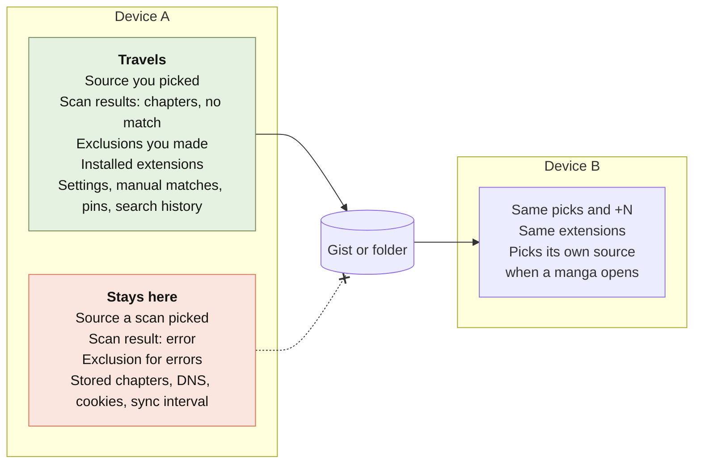
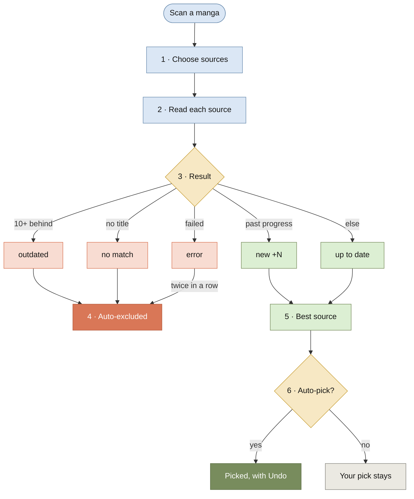
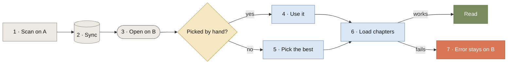

# Sync and source picking

How your library's reading setup follows you across devices, and how a scan decides which source a manga reads from. What each record and rule *means* in full lives in [okf/](../okf/index.md) ([sync stamps](../okf/stores/sync-meta.md), [sync state](../okf/stores/sync-state.md), [source probe](../okf/concepts/source-probe.md), [source exclusion](../okf/concepts/source-exclusion.md)); this page shows how the pieces fit.

## The rule

**What you decide travels. What happens to one device stays on it.**

A source can work on your phone and fail on your computer: a different runtime, network or DNS. So an error, an exclusion caused by errors, or a source a scan picked by itself never leaves the device it happened on. Your own choices, and what a scan learned about the source itself, go everywhere.

What is green travels, what is red stays. A source you picked by hand always beats one a scan picked, on every device, however old.

## What syncs

| Data | Syncs | Why |
|---|---|---|
| Source picked by hand | ✅ | Your decision, and it wins over a scan's pick |
| Source a scan picked | ❌ | Another device may read that source badly; it picks its own |
| Scan result with chapters or no match | ✅ | It describes the source, so other devices get the `+N` without asking it |
| Scan result that failed | ❌ | The failure may belong to this device |
| Exclusion you made, or for lagging / no match | ✅ | It describes the source |
| Exclusion for errors | ❌ | Same as a failed result |
| Manual matches, pins, search history, settings | ✅ | |
| Installed extensions | ✅ | Other devices install and uninstall the same ones |
| Stored chapters, cookies, DNS, sync interval, folder | ❌ | Device data, or too large |

## When it runs

- On launch and when the app comes back to the foreground.
- Every few minutes while open: 1, 5 or 15, or never, chosen per device (5 by default).
- 3 seconds after you change something that syncs, at most once a minute while changes keep coming (a scan).
- On desktop, a second after another device's file changes in the sync folder; on the web, when the browser is back online.

Runs never overlap. A failed run keeps everything for the next one. GitHub limits writes per user across all your devices: when it asks to wait, the gist waits that long while a folder keeps syncing.

## When two devices disagree

Every change stamps the record it touched (one manga, or one manga on one source) with its time. When copies meet, the newer one wins; on a tie, the one already synced wins, so a new device adopts what's there and adds only what it alone has. A removal travels as a dated tombstone, kept 90 days.

## Gist or folder

- **Gist**: a private GitHub gist, connected from Settings → Sync with GitHub's code sign-in (a pasted token on the web). Works everywhere, needs internet.
- **Folder**: a folder another app keeps in sync (iCloud Drive, OneDrive, Syncthing). Desktop watches it; Android and iOS read it on the usual triggers. Not in a plain browser.

A device can use both. Each device writes its own files (`anipoex-<table>.<device>.json`) and reads everyone's. Disconnecting removes this device's files only when another device already holds every record in them.

## How a scan picks a source

A scan reads every source for one manga, judges each result as it lands, then picks the best one.

1. **Choose sources**: installed, in your languages, not excluded. A Reading scan also skips sources read in the last hour and those with no match in the last 7 days, unless you pick *Rescan everything*.
2. **Read each source**: the page it already found for the manga, or a search by title, then its chapters. Up to 10 sources at once.
3. **Result**, the first that holds:
   - **error**: the read failed or timed out;
   - **no match**: no equal title, or no chapters;
   - **outdated**: 10 or more chapters behind your progress;
   - **new**: chapters past your progress, the `+N`;
   - **up to date**: otherwise.
4. **Auto-excluded**: outdated and no match right away; an error only on its second scan in a row.
5. **Best source**: the most new chapters, then one without a Cloudflare check, then your language order, then the name. Sources with suspicious numbering are left out.
6. **Auto-pick**: only when it's on in Settings and you haven't picked a source by hand. It says "Now reading from X · +N" with *Undo*.

Rules that hold throughout:

- **Your choices win.** A scan never replaces a source you picked, never auto-excludes a source you pinned (excluding or including it by hand pins it), and never undoes an exclusion you made.
- **The chosen source is spared** an error or a lag while it's being read (it may pass), but not a no match: it has nothing to read, so it's excluded and unchosen.
- **Exclusions come back.** An auto-exclusion older than 7 days is checked again on Scan all: dropped if the source recovered. *Retry auto-excluded* and *Reset all* in the source sheet do it on demand.
- **Auto-pick can be turned off** in Settings ("Auto-pick a source").
- **Slow sources** past "Skip slow sources" (1 minute by default) are left out of a Reading scan; Activity can retry them.

## Opening a manga on another device

1. **Scan on A**: A picks a source for the manga; that pick stays on A.
2. **Sync**: A's scan results and the sources you picked by hand reach B.
3. **Open on B**: nothing was fetched for the manga before this.
4. **Use it**: a source you picked by hand wins on every device.
5. **Pick the best**: from A's results, by the same rule as a scan; the pick stays on B.
6. **Load chapters**: only when B hasn't stored them.
7. **Error stays on B**: "Couldn't load chapters"; A keeps reading from that source.

If B doesn't have the extension yet, the manga shows "Pick a source" until the sync finishes installing it.

## The +N

The `+N` on a manga is how many whole chapters its chosen source has past your progress. With no source chosen yet (a device that only got another's scan results), it's the `+N` of the furthest-ahead source it could read from. The rules are in [unread chapters](../okf/metrics/unread-chapters.md).

## Questions

**A source works on my phone but not on my computer. Will it break the phone?**
No. The computer's error, and any exclusion it causes, stay on the computer. A source you picked by hand stays picked everywhere; one a scan picked is replaced by the next scan on the device where it fails.

**Why didn't my other device install an extension?**
Its repos don't list it: a repo may have dropped it after you installed it elsewhere. It's skipped without a notice. An install that fails for another reason shows a notice and is tried again on the next launch.

**Why did a manga pick a different source on each device?**
A scan's pick stays on its device, so each device picks from what it can read. Pick the source by hand and every device uses it.

**Why is the web app in a browser not picking anything?**
A plain browser can't run extensions: it carries the synced data but never scans, picks or installs.
